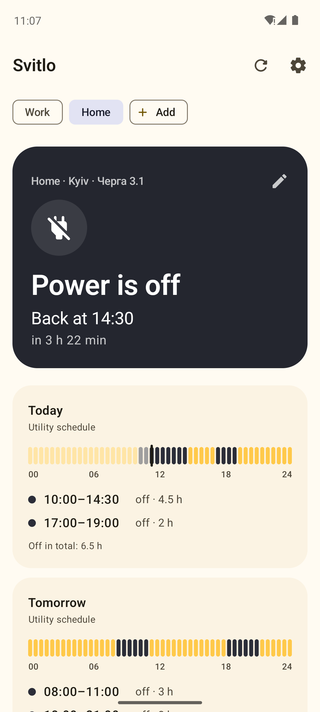
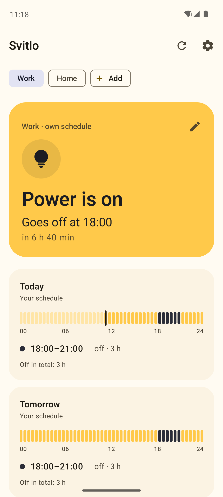
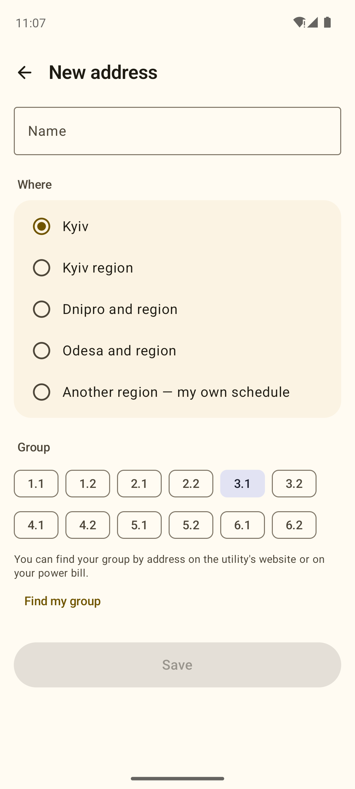
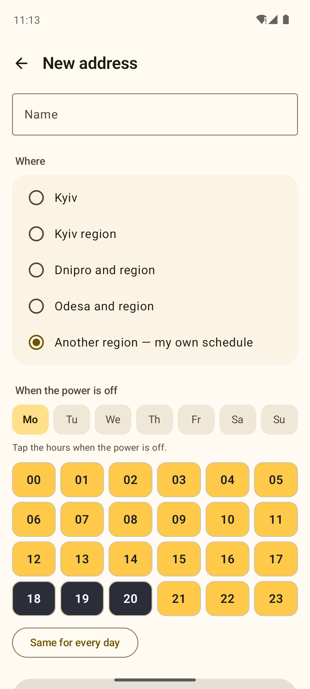

# Svitlo

  
  
  
  

<a href="README.md">Українська</a> &nbsp;|&nbsp; <b>English</b>

**Svitlo** ("light" in Ukrainian) shows the power outage schedule for your group in Ukraine: whether the power is on now, when it goes off and when it comes back. It reminds you 15 minutes before an outage, has a home-screen widget and several addresses — home, work, parents. No ads.

  

  
  
  
  

Real screenshots: GitHub Actions runs the app in an Android 14 emulator with a test schedule.

## Features

- **Now:** a big card — "Power is on · goes off at 13:00" or "Power is off · back at 18:00" — with a countdown.
- **Today and tomorrow:** a half-hour timeline and the list of outages. If tomorrow's schedule isn't out yet, possible outages from the weekly plan are shown.
- **Reminders** 5, 15, 30 or 60 minutes before an outage; optionally when power comes back and about possible outages.
- **Schedule changes:** checked every hour, with a notification when the schedule changes or tomorrow's is published.
- **Several addresses**, a **widget**, and **offline** use with the last saved schedule.

## Regions

Schedules load automatically for **Kyiv, Kyiv region, Dnipro and region, Odesa and region** from the open [outage-data-ua](https://github.com/Baskerville42/outage-data-ua) project, which collects them from DTEK pages every few minutes. For **other regions** you tap your group's hours once on a weekly grid, and reminders and the widget work the same way.

## Permissions

`INTERNET` to download schedules, `POST_NOTIFICATIONS` for reminders, `SCHEDULE_EXACT_ALARM` for on-the-minute reminders (if you allow it), `RECEIVE_BOOT_COMPLETED` to restore reminders after a reboot. No location, contacts or ads.

## License

[MIT](LICENSE). Schedule data from [outage-data-ua](https://github.com/Baskerville42/outage-data-ua) (MIT), collected from DTEK pages.
