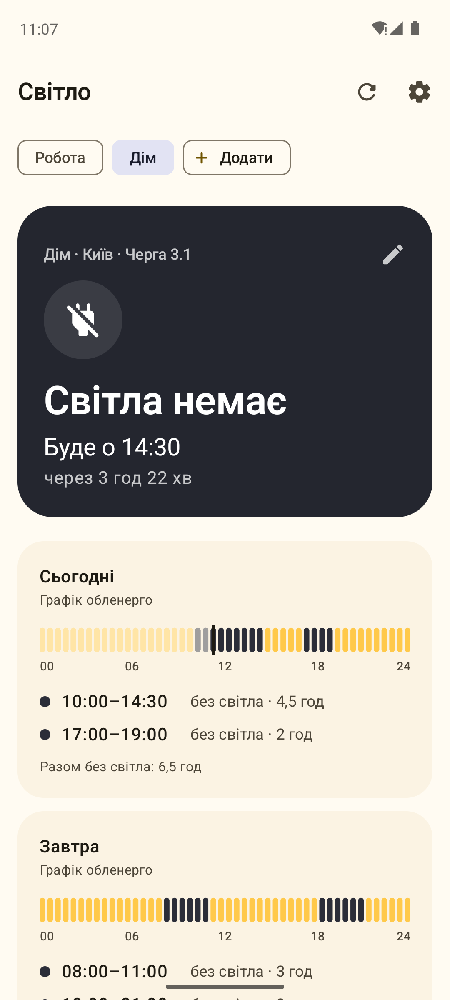
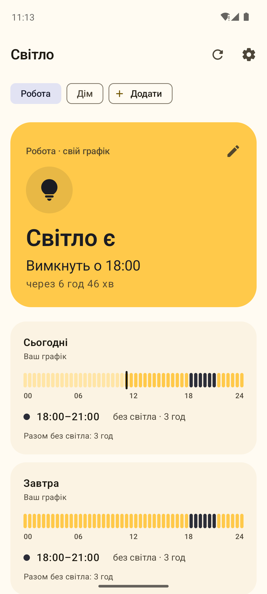
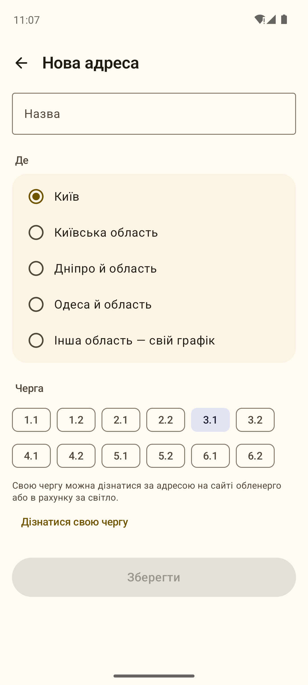
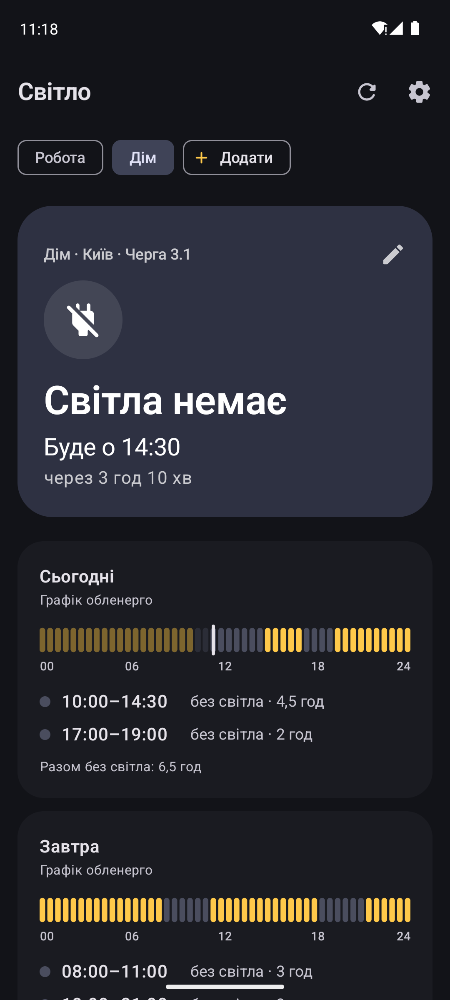
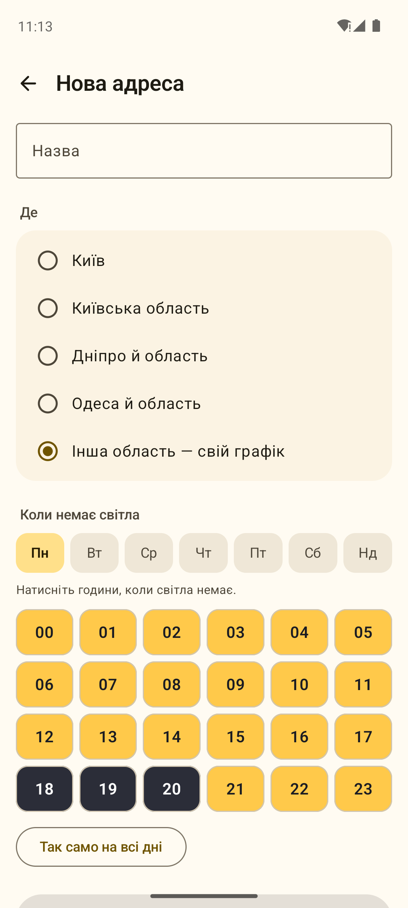
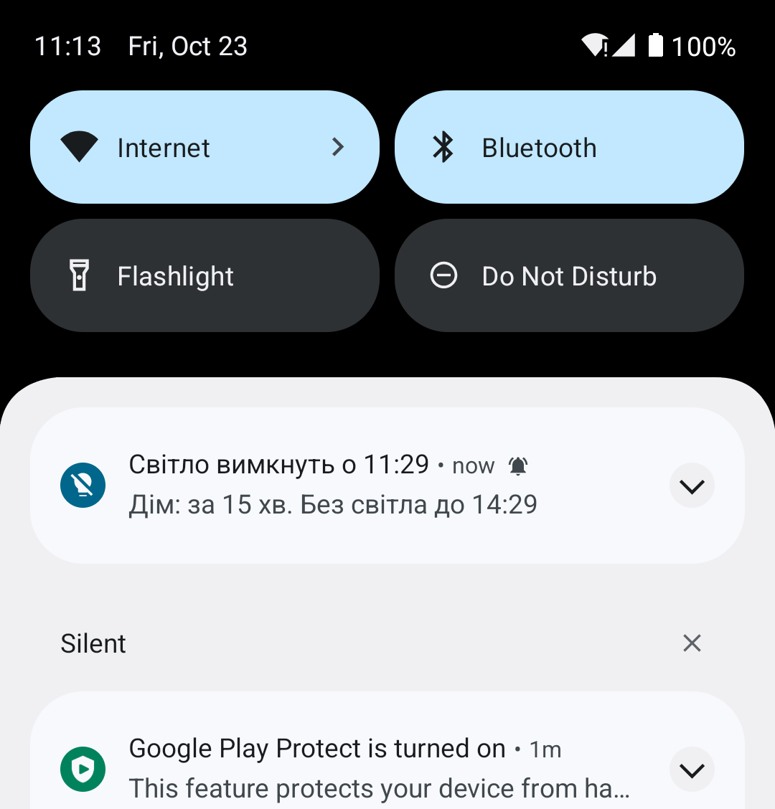

# Світло

<p>
  <a href="https://github.com/hatogg/Svitlo/releases/latest"></a>
  <a href="https://github.com/hatogg/Svitlo/actions/workflows/build.yml"></a>
  
  
  <a href="LICENSE"></a>
</p>

<p><b>Українська</b> &nbsp;|&nbsp; <a href="README.en.md">English</a></p>

**Світло** показує графік відключень електроенергії для вашої черги: чи є зараз світло, коли вимкнуть і коли повернеться. Нагадує за 15 хвилин до відключення, має віджет на головний екран і кілька адрес — дім, робота, батьки. Без реклами.

<p>
  <a href="https://github.com/hatogg/Svitlo/releases/latest"></a>
</p>

<p align="center">
  
  
  
  
</p>
<p align="center">
  
  
</p>

<sub>Справжні скриншоти: GitHub Actions запускає програму в емуляторі Android 14 з тестовим графіком.</sub>

## Що вміє

| | |
| --- | --- |
| 💡 **Зараз** | Велика картка: «Світло є · вимкнуть о 13:00» або «Світла немає · буде о 18:00», зі зворотним відліком. |
| 📊 **Сьогодні й завтра** | Шкала дня з точністю до пів години й список відключень. Якщо графіка на завтра ще немає — показує можливі відключення з тижневого графіка. |
| 🔔 **Нагадування** | За 5, 15, 30 хвилин чи годину до відключення; за бажанням — коли світло має повернутися і про можливі відключення. |
| 🔄 **Зміни графіка** | Щогодини перевіряє графік і сповіщає, якщо його змінили або опублікували на завтра. |
| 🏠 **Кілька адрес** | Дім, робота, батьки — кожна зі своєю чергою. |
| 📱 **Віджет** | «Світла немає · буде о 18:00» і шкала дня просто на головному екрані. |
| 📴 **Офлайн** | Останній графік зберігається: без інтернету видно, коли його оновлено. |

## Які регіони

Графіки завантажуються самі для **Києва, Київської області, Дніпра й області, Одеси й області** — з відкритого проєкту [outage-data-ua](https://github.com/Baskerville42/outage-data-ua), який кожні кілька хвилин збирає їх зі сторінок ДТЕК. Для **інших областей** є свій графік: один раз натискаєте години своєї черги на тижневій сітці — і нагадування й віджет працюють так само.

Графік може змінитися будь-коли — орієнтуйтеся й на повідомлення свого обленерго.

## Встановлення

1. Завантажте `Svitlo-1.0.apk` з [релізу](https://github.com/hatogg/Svitlo/releases/latest) на телефоні.
2. Відкрийте файл і дозвольте встановлення з цього джерела.
3. Додайте адресу, виберіть регіон і чергу, дозвольте сповіщення.
4. Щоб нагадування приходили хвилина в хвилину: **Налаштування → Дозволити точні нагадування**.
5. Віджет: довге натискання на головному екрані → **Віджети → Світло**.

## Дозволи

`INTERNET` — завантажити графік; `POST_NOTIFICATIONS` — нагадування; `SCHEDULE_EXACT_ALARM` — точний час нагадувань (за вашим дозволом); `RECEIVE_BOOT_COMPLETED` — відновити нагадування після перезавантаження. Ні місця, ні контактів, ні реклами — збірка в CI падає, якщо такий дозвіл з'явиться.

## Збірка

```bash
./gradlew :app:testDebugUnitTest :app:assembleRelease
```

Kotlin, Jetpack Compose, Material 3, Glance (віджет), WorkManager, AlarmManager.

## Ліцензія

[MIT](LICENSE). Дані графіків — проєкт [outage-data-ua](https://github.com/Baskerville42/outage-data-ua) (MIT) зі сторінок ДТЕК.
